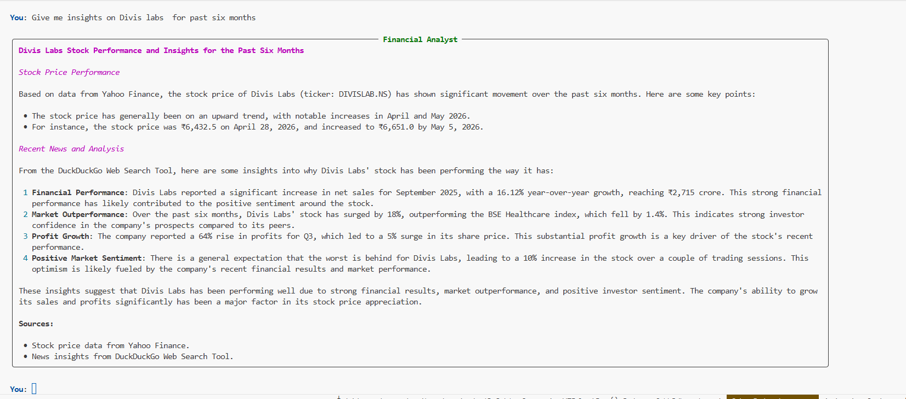

# Learning LangChain

This directory contains introductory examples and exercises for building AI agents using LangChain and LangGraph.

## Modules

* [Example 1: Hello Agent (`hello_agent.py`)](./hello_agent.py) - A very basic LangChain agent setup using a simple prompt and LLM combination.
* [Example 2: Agent with Memory (`agent_with_memory.py`)](./agent_with_memory.py) - Demonstrates how to add conversational memory to an agent so it remembers previous turns.
* [Example 3: Chatbot with Tools (`chatbot.py`)](./chatbot.py) - A "smart" agent that uses the Tavily search API to retrieve up-to-date information from the web.
* [Example 4: Financial Analyst (`financial_analyst.py`)](./financial_analyst.py) - A specialized ReAct agent using LangGraph that fetches stock data via Yahoo Finance (`yfinance`) and reasons about market news using DuckDuckGo search.

* [Example 5: Financial Analyst Workflow (`financial_analyst_workflow.py`)](./financial_analyst_workflow.py) - A refactored version of the financial analyst agent that uses a clean LangGraph state management, system prompts, and encapsulated node logic.
* [Example 6: Financial Analyst — With Guardrails (`financial_analyst_workflow_with_guardrail.py`)](./financial_analyst_workflow_with_guardrail.py) - Production-depth extension of Example 5. Adds:
  - **Guardrail node** — keyword/regex pre-LLM filter that blocks off-topic queries and routes to END without spending any API tokens.
  - **Expanded `AgentState`** — explicit `current_ticker`, `sources_used`, and `violation_count` fields; each owned and written by the node most responsible for that data.
  - **Structured tool errors** — both tools return `{"status": "error", "message": ..., "code": ...}` on failure, preventing LLM retry loops.
  - **`CustomToolNode`** — subclass of LangGraph's `ToolNode` that records which data sources were invoked into state.

## Utilities

* [`load_env.py`](./load_env.py) - A utility script to load environment variables from the `.env` file securely.

## Tests

* [`tests/test_financial_analyst_guardrail.py`](./tests/test_financial_analyst_guardrail.py) - 15 pytest unit tests covering guardrail classification, off-topic blocking, structured error returns, graph compilation, and `violation_count` state tracking.

  Run with:
  ```bash
  pytest learning_langchain/tests/test_financial_analyst_guardrail.py -v
  ```
